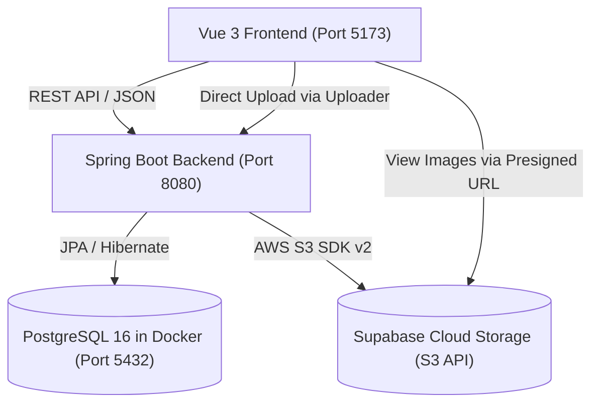

# SE 331 Component-Based Software Development: Comprehensive Lab Summary & Lab 12 Handoff Document

This document provides a complete technical summary of the system architecture, code structure, configuration, and data models established through Lab 11. It serves as the definitive reference for continuing development into Lab 12.

---

## 1. Project Overview and Directory Structure

The project consists of a decoupled Full-Stack architecture: a Spring Boot REST API backend and a Vue 3 TypeScript Single Page Application (SPA) frontend, backed by a PostgreSQL database running in Docker and Supabase Storage (AWS S3-compatible) for cloud media storage.

### 1.1 Physical File Paths

- **Backend Project Root (Lab 12)**: `d:/IDEPRO/lad12`
- **Frontend Project Root (Lab 12)**: `d:/Component-Based/lad12/331-frontend-firstpart-main`
- **Prior Backend (Lab 10)**: `d:/IDEPRO/lad12`
- **Prior Frontend (Lab 10)**: `d:/Component-Based/lad12/331-frontend-firstpart-main`



---

## 2. Infrastructure and Environment Configuration

### 2.1 Database (PostgreSQL via Docker)

- **Container Name**: `lad12-db-1`
- **Image**: `postgres:16-alpine`
- **Port Mapping**: `5432:5432`
- **Database Name**: `selabdb`
- **Database User**: `selab`
- **Database Password**: `selab`
- **Adminer Web UI**: Port 9000 (container `lad12-adminer-1`)

Startup command when containers are stopped:
```powershell
docker start lad12-db-1 lad12-adminer-1
```

### 2.2 Backend Application Profiles

Configured in [application.yml](file:///d:/IDEPRO/lad%2011/src/main/resources/application.yml):
```yaml
spring:
  profiles:
    active:
      - db
      - local
  servlet:
    multipart:
      max-file-size: 10MB
      max-request-size: 10MB
```

Credentials file: [application-local.yml](file:///d:/IDEPRO/lad%2011/src/main/resources/application-local.yml)
> [!IMPORTANT]
> The file `application-local.yml` contains private credentials and is strictly excluded from version control via `.gitignore`. Never commit this file.

```yaml
supabase:
  storage:
    endpoint: https://xzcfbrvsqlbusmsjquod.storage.supabase.co/storage/v1/s3
    bucket: test
    region: ap-south-1
    accessKey: 040fb596f798e381a1dde6e5f7f8be7f
    secretKey: [REDACTED_SECRET_KEY]
```

### 2.3 Frontend Environment Variables

Configured in [`.env.development`](file:///d:/Component-Based/lad%2011/331-frontend-firstpart-main/.env.development):
```env
VITE_BACKEND_URL=http://localhost:8080
VITE_UPLOAD_URL=http://localhost:8080/uploadImage
```

---

## 3. Backend Architecture and Implementation (Lab 1 - Lab 11)

### 3.1 Domain Entities

All entities are located in [`se331.lad12.entity`](file:///d:/IDEPRO/lad%2011/src/main/java/se331/lad12/entity/):

1. **`Event`** ([Event.java](file:///d:/IDEPRO/lad%2011/src/main/java/se331/lad12/entity/Event.java)):
   - `Long id` (PK, Identity)
   - `String category`, `title`, `description`, `location`, `date`, `time`
   - `Boolean petsAllowed`
   - `@ManyToOne Organizer organizer`
   - `@ManyToMany(mappedBy = "eventHistories") List<Participant> participants`
   - `@ElementCollection List<String> images` (Stores multiple S3 object keys)

2. **`Organizer`** ([Organizer.java](file:///d:/IDEPRO/lad%2011/src/main/java/se331/lad12/entity/Organizer.java)):
   - `Long id` (PK, Identity)
   - `String name`
   - `String image` (Stores a single S3 object key)
   - `@OneToMany(mappedBy = "organizer") List<Event> ownEvents`

3. **`Participant`** ([Participant.java](file:///d:/IDEPRO/lad%2011/src/main/java/se331/lad12/entity/Participant.java)):
   - `Long id` (PK, Identity)
   - `String name`, `telNo`
   - `@ManyToMany List<Event> eventHistories`

### 3.2 Data Transfer Objects (DTO) and MapStruct

Data transfer objects decouple entity models from API representations:
- [`EventDTO`](file:///d:/IDEPRO/lad%2011/src/main/java/se331/lad12/entity/EventDTO.java) includes `List<String> images`
- [`OrganizerDTO`](file:///d:/IDEPRO/lad%2011/src/main/java/se331/lad12/entity/OrganizerDTO.java) includes `String image`
- [`StorageFileDto`](file:///d:/IDEPRO/lad%2011/src/main/java/se331/lad12/util/StorageFileDto.java) with `String name` (required by `vue-media-upload`)

The mapper interface [`LabMapper.java`](file:///d:/IDEPRO/lad%2011/src/main/java/se331/lad12/util/LabMapper.java) uses MapStruct:
```java
@Mapper
public interface LabMapper {
    LabMapper INSTANCE = Mappers.getMapper(LabMapper.class);
    EventDTO getEventDto(Event event);
    List<EventDTO> getEventDto(List<Event> events);
    OrganizerDTO getOrganizerDTO(Organizer organizer);
    List<OrganizerDTO> getOrganizerDTO(List<Organizer> organizers);
}
```

> [!WARNING]
> Whenever fields are added to an Entity or DTO, MapStruct does NOT automatically recompile with standard incremental builds. You must execute `./mvnw clean compile` to regenerate `LabMapperImpl.java`.

### 3.3 S3 Client and Presigned URL Generation

Located in [`S3Config.java`](file:///d:/IDEPRO/lad%2011/src/main/java/se331/lad12/util/S3Config.java) and [`SupabaseStorageService.java`](file:///d:/IDEPRO/lad%2011/src/main/java/se331/lad12/util/SupabaseStorageService.java):

```java
// S3Config.java
@Bean
public S3Client getAmazonS3Client() {
    AwsBasicCredentials credentials = AwsBasicCredentials.create(accessKeyId, secretAccessKey);
    return S3Client.builder()
            .credentialsProvider(() -> credentials)
            .region(Region.of(region))
            .endpointOverride(URI.create(endpoint))
            .forcePathStyle(true)
            .build();
}

@Bean
public S3Presigner s3Presigner() {
    AwsBasicCredentials credentials = AwsBasicCredentials.create(accessKeyId, secretAccessKey);
    return S3Presigner.builder()
            .credentialsProvider(() -> credentials)
            .region(Region.of(region))
            .endpointOverride(URI.create(endpoint))
            .serviceConfiguration(S3Configuration.builder()
                    .pathStyleAccessEnabled(true)
                    .build())
            .build();
}
```

> [!NOTE]
> `pathStyleAccessEnabled(true)` is strictly necessary. Supabase uses wildcard SSL certificates covering only single subdomains (`*.storage.supabase.co`). Without path style, virtual-hosted style generates `bucket.project.storage.supabase.co`, triggering `ERR_SSL_VERSION_OR_CIPHER_MISMATCH` in web browsers.

### 3.4 REST Endpoints Catalog

| Method | Endpoint | Description | Request Body / Params |
|---|---|---|---|
| `GET` | `/events` | Paginated event list | `_limit`, `_page`, `title`, `description` |
| `GET` | `/events/{id}` | Single event details | Path variable `id` |
| `POST` | `/events` | Create new event | JSON body `Event` |
| `GET` | `/organizers` | List all organizers | None |
| `GET` | `/organizers/{id}` | Single organizer details | Path variable `id` |
| `POST` | `/organizers` | Create new organizer | JSON body `Organizer` |
| `POST` | `/uploadFile` | Raw file upload to S3 | Multipart form-data `file` |
| `POST` | `/uploadImage` | Image upload with validation | Multipart form-data `image`, returns `{ name: "key" }` |
| `GET` | `/presignedUrl` | Generate 60-min Presigned URL | Param `fileName` or `key` |

---

## 4. Frontend Architecture and Implementation (Lab 1 - Lab 11)

### 4.1 Libraries and Packages

- **Vue 3**: Composition API with `<script setup lang="ts">`
- **State Management**: Pinia (`useEventStore`, `useMessageStore`)
- **Routing**: Vue Router 5 with dynamic routing and `beforeEnter` resolvers
- **HTTP Client**: Axios with centralized instances in `EventService` and `OrganizerService`
- **UI & Styling**: Tailwind CSS 4
- **Media Upload**: `vue-media-upload` (Dropzone with instant upload to backend)

### 4.2 Type Definitions ([types.ts](file:///d:/Component-Based/lad%2011/331-frontend-firstpart-main/src/types.ts))

```typescript
export interface Event {
  id: number | null
  category: string
  title: string
  description: string
  location: string
  date: string
  time: string
  petsAllowed: boolean
  organizer: Organizer
  images: string[]
}

export interface Organizer {  
  id: number | null
  name: string
  organizationName?: string
  address?: string
  image?: string
}
```

### 4.3 Core Views and Routing Table

Routes defined in [`src/router/index.ts`](file:///d:/Component-Based/lad%2011/331-frontend-firstpart-main/src/router/index.ts):

| Route Path | Name | Component | Functionality |
|---|---|---|---|
| `/` | `event-list-view` | `EventListView.vue` | Paginated list of events |
| `/add-event` | `add-event` | `EventFormView.vue` | Event form with multiple image upload |
| `/event/:id` | `event-layout-view` | `LayoutView.vue` | Event layout with nested child routes |
| `/event/:id/` | `event-detail-view` | `DetailView.vue` | Event details + image gallery via Presigned URLs |
| `/event/:id/register` | `event-register-view` | `RegisterView.vue` | Event registration view |
| `/event/:id/edit` | `event-edit-view` | `EditView.vue` | Event edit view |
| `/organizer` | `organizer-list-view` | `OrganizerListView.vue` | Paginated list of organizers |
| `/organizer/:id` | `organizer-detail-view` | `OrganizerDetailView.vue` | Single organizer detail + circular avatar |
| `/add-organizer` | `add-organizer` | `OrganizerFormView.vue` | Organizer form with single image upload |

### 4.4 Image Handling Logic

1. **Multiple Images for Event ([`EventFormView.vue`](file:///d:/Component-Based/lad%2011/331-frontend-firstpart-main/src/views/event/EventFormView.vue))**:
   - Uses `<ImageUpload v-model="event.images" />`
   - Each uploaded file generates an S3 key pushed to `event.images: string[]`
   - Detail view fetches presigned URLs with `EventService.getEventImages(event.images)`

2. **Single Image for Organizer ([`OrganizerFormView.vue`](file:///d:/Component-Based/lad%2011/331-frontend-firstpart-main/src/views/organizer/OrganizerFormView.vue))**:
   - Bound to an array `const organizerImages = ref<string[]>([])`
   - Enforces single image constraint using `watch`:
     ```typescript
     watch(organizerImages, (newImages) => {
       if (newImages.length > 1) {
         organizerImages.value = [newImages[newImages.length - 1]!]
       }
     })
     ```
   - On submission, assigns `organizer.value.image = organizerImages.value[0] || ''`

---

## 5. Critical Issues, Pitfalls, and Solutions Log

| Issue Encountered | Root Cause | Implemented Solution |
|---|---|---|
| `ERR_SSL_VERSION_OR_CIPHER_MISMATCH` when opening presigned URLs | S3Presigner defaulted to virtual-hosted style (`bucket.project.storage...`), violating single-level wildcard SSL certificate. | Added `.serviceConfiguration(S3Configuration.builder().pathStyleAccessEnabled(true).build())` to `s3Presigner()` bean. |
| `[TSCONFIG_ERROR] Failed to load tsconfig.json` | An `"include"` directive was erroneously appended into `tsconfig.json` without comma separation. | Restored clean `tsconfig.json` with only `files` and `references`; placed `"index.d.ts"` inside `tsconfig.app.json`. |
| `Ambiguous mapping` on `/presignedUrl` | Duplicate `@GetMapping("/presignedUrl")` methods in `SupabaseController.java`. | Merged into a single method accepting optional parameters: `@RequestParam(value = "fileName", required = false)` and `@RequestParam(value = "key", required = false)`. |
| Event saved with `"images": []` empty array | 1) Submit button placed before upload element.<br>2) MapStruct mapper compiled before `images` field was added. | 1) Moved Submit button below `<ImageUpload>`.<br>2) Ran `./mvnw clean compile` to force MapStruct to regenerate mapper with `eventDTO.images(...)`. |
| Broken image links after several hours | Presigned URLs have a fixed 60-minute TTL. | Hard reload (Ctrl + F5) or re-fetching via `EventService.getEventImages()` issues fresh URLs with valid signatures. |

---

## 6. Lab 12 Preparation Checklist

Before initiating Lab 12 tasks:

- [ ] **Docker Database**: Ensure container is running:
  ```powershell
  docker start lad12-db-1 lad12-adminer-1
  ```
- [ ] **Backend Run**: In IntelliJ IDEA, run `Lad12Application` from `d:/IDEPRO/lad12`. Verify output:
  ```text
  Tomcat started on port 8080 (http) with context path ''
  ```
- [ ] **Frontend Run**: In `d:/Component-Based/lad12/331-frontend-firstpart-main`, execute:
  ```powershell
  npm run dev
  ```
  Verify dev server is active on `http://localhost:5173/`.
- [ ] **Git Tracking**: Confirm both repositories are on clean working trees:
  - Backend: `d:/IDEPRO/lad12` (ensure `application-local.yml` remains untracked/ignored)
  - Frontend: `d:/Component-Based/lad12/331-frontend-firstpart-main`
